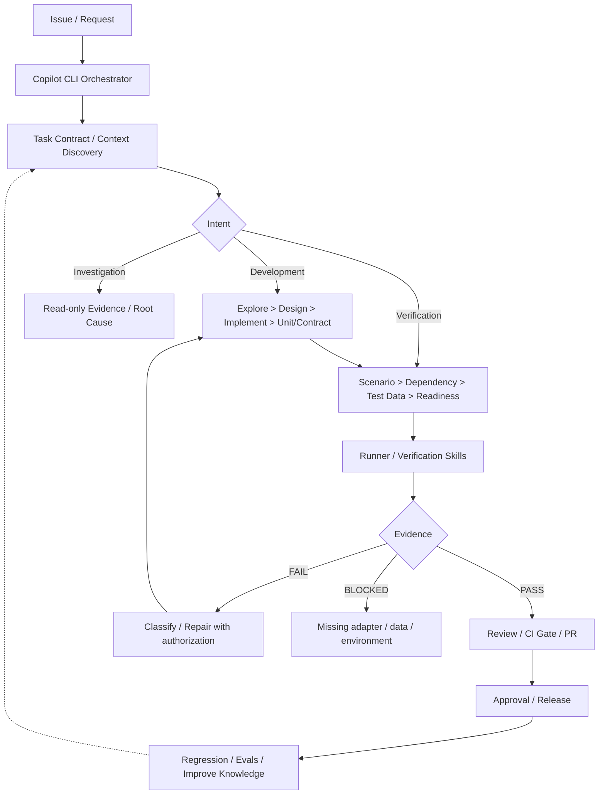

# Copilot SDLC — Enterprise AI SDLC v0.1

**GitHub Copilot CLI-first framework: one task entry point, separate development/testing tracks, shared evidence-driven verification.**

> Status: **executable initial scaffold**, not a production-ready autonomous deployment platform. The included three-system journey is a **local, in-memory simulation**. No bank, payment, external API or production integration is configured. This project is an independent implementation inspired by Lauren Tan's verification-first ideas, not an official pstack port.

## Architecture



## Quick start (Python 3.11+, stdlib only)

```bash
git clone https://github.com/jerry79618/Copilot_sdlc.git
cd Copilot_sdlc
python -m unittest discover -s tests -v
python -m sdlc.cli validate --task contracts/examples/verification.json
python -m sdlc.cli plan --task contracts/examples/development.json
python -m sdlc.cli verify --task contracts/examples/verification.json
```

Last command writes a timestamped JSON evidence file to `artifacts/`. It checks the fixture, orders steps by dependencies, executes a **mock risk → application → sync journey**, and verifies three assertions. The result contains `classification: DEMO_VERIFIED`, **not** a real E2E certification.

For a non-demo environment, the safe behavior is intentional:

```bash
python -m sdlc.cli verify --task contracts/examples/verification.json
# Try setting "environment" to "staging" in a *copy* of the contract:
# result = BLOCKED / EXTERNAL_ADAPTER_UNAVAILABLE, exit code 2
```

## Use with GitHub Copilot CLI

Install/sign into GitHub Copilot CLI according to [GitHub Docs](https://docs.github.com/en/copilot/how-tos/copilot-cli/use-copilot-cli/overview); enter the repository and run `copilot`.

Example prompt (no unofficial slash command required):

> Use the orchestrator agent and task-routing skill. Implement the requirements in `contracts/examples/development.json`. Explore the repository first, explain the actual code changes, keep all non-demo integrations blocked, run the contract checks and verification suite, then report evidence and unresolved gaps. Do not deploy.

For testing-only:

> Use the tester agent and verification skill for `contracts/examples/verification.json`. Do not change product code. Run scenario readiness and verification, distinguish PASS from BLOCKED, and link the JSON evidence.

Select agents using `/agent` or `copilot --agent tester --prompt "..." ` where supported. See `.github/agents/`, `.github/skills/`, `AGENTS.md`.

## Repository map

| Directory | Responsibility |
| --- | --- |
| `sdlc/` | Deterministic Task Contract validation, routing, demo runner, evidence |
| `.github/agents/` | Orchestrator / developer / tester / reviewer agent definitions |
| `.github/skills/` | Reusable route, implementation, verification, cross-system data, failure triage |
| `contracts/examples/` | Sample development, testing, investigation requests |
| `scenarios/` | Ordered steps, dependencies and assertions |
| `fixtures/` | Synthetic-only seed data |
| `docs/feature-map/` | Human/agent-readable navigation + verification guidance |
| `docs/` | Architecture, quality gates, adapter interface and future work |
| `tests/` | Python contract/runtime/evaluation tests |
| `.github/workflows/ci.yml` | Mandatory deterministic validation and example evidence on pushes/PRs |

## Gates and outcomes

G1 Spec → G2 Verifiability → G3 Readiness → G4 Execution → G5 Independent Review/CI → G6 Release approval.

`PASS` means verified against the **explicit adapter and evidence**; `FAIL` means an assertion failed; `BLOCKED` means the prerequisites/adapter are unavailable; `ERROR` means malformed inputs or internal runtime errors. Exit codes: 0/1/2/3 respectively.

**Do not treat prompt text as access control.** Configure repository rulesets, CI required checks, environment protection, approved adapters, and credentials in the target organization before enabling real integrations. The initial repo cannot enforce these GitHub settings itself.

## Initial scope / intentionally not done

- No Copilot CLI API call is automated by Python. Agent invocation and task interpretation use Copilot CLI with repository agents/skills; the Python side is a deterministic contract and demonstration verifier.
- No live external system, real credentials, automatic write API, database writes, continuous incident processing or production deployment.
- No claim that a synthetic three-service simulation proves a banking integration.
- Dynamic Workflows, authenticated test data provisioning, Cucumber/Selenium/Java adapters, reliable cleanup, long-running async polling, and production ruleset configuration are later phases; see `docs/roadmap.md`.

## References

- [GitHub Copilot CLI custom agents](https://docs.github.com/en/copilot/how-tos/copilot-cli/customize-copilot/create-custom-agents-for-cli)
- [GitHub Copilot CLI skills](https://docs.github.com/en/copilot/how-tos/copilot-cli/customize-copilot/add-skills)
- [Lauren Tan verification-skill example](https://github.com/poteto/verification-skill-example)
