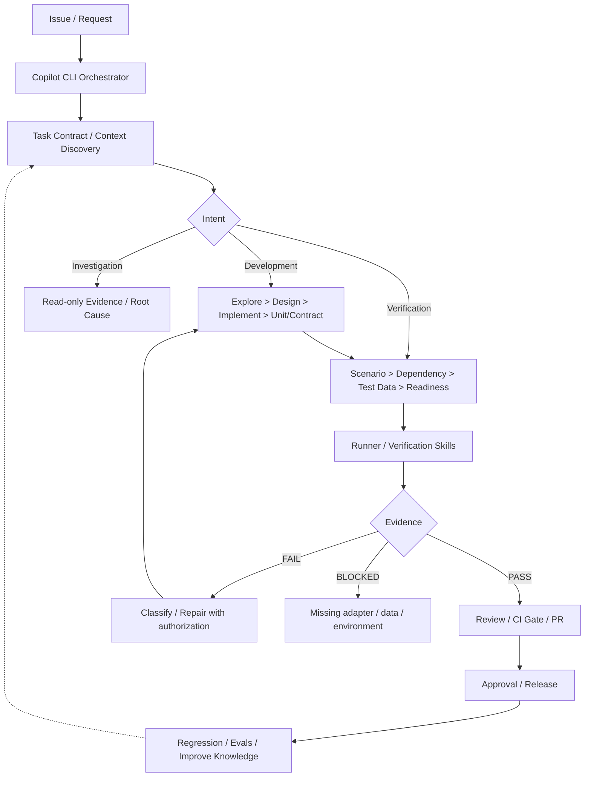

# Copilot SDLC — Enterprise AI SDLC v0.8

**GitHub Copilot CLI-first framework: goal-first Poteto Mode, eleven Playbooks, staged Skills, development/testing separation and auditable verification evidence.**

> Status: **executable initial scaffold**, not a production-ready autonomous deployment platform. The included three-system journey is a **local, in-memory simulation**. No bank, payment, external API or production integration is configured. This project is an independent implementation inspired by Lauren Tan's verification-first ideas, not an official pstack port.


## Poteto Mode — native Copilot CLI entry

The canonical goal-first mode is the **native `poteto-mode` Agent Skill** in
`.github/skills/poteto-mode/SKILL.md`. The `orchestrator` custom Agent,
Python `sdlc.mode` engine, eleven Playbooks and bank gates are unchanged.
This is our own Copilot adaptation, not Lauren Tan's official Cursor Plugin.

~~~powershell
cd D:\git\Copilot_sdlc
.\scripts\start-poteto.ps1 -ProjectRoot "D:\git\bank-application" -CheckOnly
.\scripts\start-poteto.ps1 -ProjectRoot "D:\git\bank-application" -Isolated -Goal "補齊查詢測試，不要修改產品程式碼"
~~~

Within a session where the Framework is visible, inspect `/skills list` and
`/skills info poteto-mode`. To call it explicitly, say `Use the /poteto-mode
skill to ...` in the prompt. That refers to Copilot's Agent Skill, not the
same slash-command implementation as the Cursor plugin.

Legacy `scripts/start-sdlc.ps1` and `sdlc-mode` continue as compatibility
aliases. See [Poteto Mode guide](docs/poteto-mode.md).

## pstack upstream source integration (v0.8)

Lauren Tan's original pstack material is now available **inside this repo**
under vendor/pstack/, pinned to upstream version 0.15.42 (MIT). It includes
the original mode, 23 playbooks, and selected verification and engineering
Skills as **read-only references**, not automatically registered Copilot Skills.

The existing eleven SDLC Playbooks and bank controls remain authoritative.
sdlc.entrypoint route returns the matching pstack_reference (exact local file
paths), so Orchestrator can draw on the original engineering method without
requiring a new prompt or Cursor plugin. The upstream Cursor-only commands,
model routing, autopilot and shipping behaviors are not enabled.

~~~powershell
python -m sdlc.pstack_bridge check
python -m sdlc.pstack_bridge route --goal "修正查詢 bug"
~~~

See [Upstream integration and MIT attribution](docs/pstack-integration.md).
This is not an official pstack port and does not add real bank E2E adapters.

## v0.6 — lean instructions with risk-based enforcement

The default AI instructions now emphasize **project context, banking invariants and autonomous delivery**, rather than repeating defensive checklists across files. Normal technical decisions can be made autonomously; report key choices and rejected alternatives in the result. GitHub CI, application verification and bank approvals remain separate enforcement mechanisms.

**Evidence requirements are risk-based** (same ordered Playbooks, fewer mandatory attachments):

| Effective risk | Mandatory evidence | Decision boundary |
| --- | --- | --- |
| Low / lean | G4 executed verification when the Playbook has a G4 stage | Ordinary technical choices are autonomous |
| Medium / standard | G2 baseline + G4 execution + G5 review when present | Signed-off banking rules still authoritative |
| High / regulated | Evidence on every mandatory stage, plus manual release approval policy | Independent specialist reviews and authorized human release approval |

Tester may maintain **test-scoped** Cucumber Gherkin/Java Steps and synthetic fixtures as part of verification unless `allow_test_changes: false`. This does not grant permission to modify production code. Real system G4 remains BLOCKED until an approved adapter exists.

Normal agents have ordered **model candidates** under `modelPolicy: required`, not arbitrary model fallback. Specialist high-risk agents remain pinned. The repository cannot verify organization entitlement, and `config/banking-model-policy.json` explicitly records `org_approval_verified: false` until admins validate the deployment; do not deploy with unapproved models.

    python -m sdlc.model_policy check
    python -m sdlc.model_policy route --task contracts/examples/banking-high-risk.json
    python -m sdlc.mode start --task contracts/examples/verification.json

See [v0.6 rationale and operating rules](docs/lean-instructions-v06.md).

## Legacy SDLC Mode v0.2 — historical flow

The current entry point is the native **`poteto-mode` Skill + `orchestrator` Agent**. The old `sdlc-mode` Skill is a compatibility alias; `/poteto-mode` in Copilot CLI is a Skill reference, not the Cursor plugin command.

```bash
# Agent-facing invocation (requires authenticated Copilot CLI)
copilot --agent orchestrator --prompt "測試跨系統人工覆核；請確認資料與環境，保存證據，不得修改產品程式碼。"

# Deterministic workflow management (no Copilot authentication required)
python -m sdlc.mode catalog
python -m sdlc.mode route --goal "新增訂單查詢 API"
python -m sdlc.mode start --task contracts/examples/verification.json
# Use the worklist file returned above:
python -m sdlc.mode status --run artifacts/worklist-TASK-VERIFY-001-<timestamp>.json
```

Workflow: **Goal → Task Contract → Select Playbook → Ordered Worklist → Skill per stage → G1–G5 Evidence → Review / Report**.

Supported Playbooks: `feature`, `bug-fix`, `verification`, `investigation`, `refactor`, `performance`, `review`, `figure-it-out`. Unknown intent defaults to read-only planning. Evidence attachments follow risk policy; the G4 runtime check still rejects unavailable external systems. Testing-only tasks cannot silently switch to source-code modification.

Read the [Poteto Mode guide](docs/poteto-mode.md), [playbook catalog](playbooks/README.md), and [canonical Skill](.github/skills/poteto-mode/SKILL.md); the original [SDLC guide](docs/sdlc-mode.md) is historical. **Copilot agent routing and delegation still require a real authenticated Copilot CLI run**; Python is the deterministic worklist engine, not an AI runtime.

## Cucumber BDD + Feature Map (v0.3)

**Testing now uses executable Cucumber-JVM Gherkin and Java Step Definitions.** The Feature Map remains behavioral, with a machine-readable link to actual tests and cross-system fixtures. See [Cucumber guide](docs/cucumber-bdd.md).

    python -m sdlc.feature_map validate
    mvn -B -ntp -f cucumber/pom.xml test
    python -m sdlc.cucumber_evidence --task contracts/examples/verification.json --feature manual-review

The JSON/HTML report lives in cucumber/target/cucumber-report/. The normalized artifacts/cucumber-evidence.json feeds SDLC G4. The demo adapter is in-memory; PASS does **not** prove a real integration.

## Banking risk-aware agents and AI credits (v0.4)

Risk-aware routing maps Task Contract risk (low/medium/high) and critical impact flags to role-specific agent models. Transaction, ledger, customer privacy, authorization and cross-system financial risks require TWO independent reviews and human release approval. All models must be approved by the bank organization.

    python -m sdlc.model_policy check
    python -m sdlc.model_policy route --task contracts/examples/banking-high-risk.json
    python -m sdlc.credit_estimate --scenario all
    python -m sdlc.credit_estimate --scenario medium --retries 1

Agent roles: orchestrator (Claude Sonnet 5.5); standard developer (GPT-6.1 Terra); complex developer (GPT-6.1 Sol); tester (Sonnet 5.5); standard reviewer (Sonnet 5.5); banking analyst/reviewer (Opus 5.5); cross-reviewer (GPT-6.1 Terra). Model availability is organization-dependent; normal Agents may choose only from configured candidate models; high-risk specialist Agents remain pinned, subject to bank model approval.

Costs use GitHub's published per-million-token rates (1 AI credit = USD 0.01), not actual agent bills. See [Bank model policy and credit methodology](docs/banking-models-and-cost.md).

## v0.5 — closer to Lauren Tan's workflow concepts

The goal-first Poteto Mode follows a stronger sequence: **Goal + Done Check → Principles → Playbook → Stage-specific Skills → Feature Map discovery → Real Verification Evidence → Independent Review → Reflection + Evaluations**. This adapts pstack's patterns without claiming the Cursor slash command works in Copilot CLI.

Additional Playbooks: prototype, skill-eval, and multi-phase planning (total **11**, not a reimplementation of pstack's 23). Existing eight Playbooks and the banking risk gates remain intact.

    # Discover Java Spring API controllers and Gherkin tags (read-only)
    python -m sdlc.discovery inspect
    # Write proposed, explicitly unverified Feature Maps under artifacts/discovery/
    python -m sdlc.discovery candidates
    # Check existing Feature Map references
    python -m sdlc.discovery health
    # Deterministic routing/Skill regression tests; NOT an LLM agent eval
    python -m sdlc.quality_eval
    # Resume a worklist without modifying it
    python -m sdlc.mode checkpoint --run artifacts/worklist-<id>.json
    # Draft lessons from a run; human review required
    python -m sdlc.reflect --run artifacts/worklist-<id>.json

See [pstack alignment and scope](docs/pstack-alignment.md), [SDLC principles](docs/principles.md) and [Feature Map discovery Skill](.github/skills/feature-map-discovery/SKILL.md). Actual Copilot agent delegation, model entitlement checks, real banking integration adapters and authenticated Agent Evals are still pending.

## Architecture



## Quick start (Python 3.11+, stdlib only)

```bash
git clone https://github.com/jerry79618/Copilot_sdlc.git
cd Copilot_sdlc
python -m unittest discover -s tests -v
python -m sdlc.cli validate --task contracts/examples/verification.json
python -m sdlc.cli plan --task contracts/examples/development.json
python -m sdlc.cli verify --task contracts/examples/verification.json
```

Last command writes a timestamped JSON evidence file to `artifacts/`. It checks the fixture, orders steps by dependencies, executes a **mock risk → application → sync journey**, and verifies three assertions. The result contains `classification: DEMO_VERIFIED`, **not** a real E2E certification.

For a non-demo environment, the safe behavior is intentional:

```bash
python -m sdlc.cli verify --task contracts/examples/verification.json
# Try setting "environment" to "staging" in a *copy* of the contract:
# result = BLOCKED / EXTERNAL_ADAPTER_UNAVAILABLE, exit code 2
```

## Use with GitHub Copilot CLI

Install/sign into GitHub Copilot CLI according to [GitHub Docs](https://docs.github.com/en/copilot/how-tos/copilot-cli/use-copilot-cli/overview); enter the repository and run `copilot`.

Example prompt (no unofficial slash command required):

> Use the orchestrator agent and task-routing skill. Implement the requirements in `contracts/examples/development.json`. Explore the repository first, explain the actual code changes, keep all non-demo integrations blocked, run the contract checks and verification suite, then report evidence and unresolved gaps. Do not deploy.

For testing-only:

> Use the tester agent and verification skill for `contracts/examples/verification.json`. Do not change product code. Run scenario readiness and verification, distinguish PASS from BLOCKED, and link the JSON evidence.

Select agents using `/agent` or `copilot --agent tester --prompt "..." ` where supported. See `.github/agents/`, `.github/skills/`, `AGENTS.md`.

## Repository map

| Directory | Responsibility |
| --- | --- |
| `sdlc/` | Deterministic Task Contract validation, routing, demo runner, evidence |
| `.github/agents/` | Orchestrator / developer / tester / reviewer agent definitions |
| `.github/skills/` | Reusable route, implementation, verification, cross-system data, failure triage |
| `contracts/examples/` | Sample development, testing, investigation requests |
| `scenarios/` | Ordered steps, dependencies and assertions |
| `fixtures/` | Synthetic-only seed data |
| `docs/feature-map/` | Human/agent-readable navigation + verification guidance |
| `docs/` | Architecture, quality gates, adapter interface and future work |
| `tests/` | Python contract/runtime/evaluation tests |
| `.github/workflows/ci.yml` | Mandatory deterministic validation and example evidence on pushes/PRs |

## Gates and outcomes

G1 Spec → G2 Verifiability → G3 Readiness → G4 Execution → G5 Independent Review/CI → G6 Release approval.

`PASS` means verified against the **explicit adapter and evidence**; `FAIL` means an assertion failed; `BLOCKED` means the prerequisites/adapter are unavailable; `ERROR` means malformed inputs or internal runtime errors. Exit codes: 0/1/2/3 respectively.

**Do not treat prompt text as access control.** Configure repository rulesets, CI required checks, environment protection, approved adapters, and credentials in the target organization before enabling real integrations. The initial repo cannot enforce these GitHub settings itself.

## Initial scope / intentionally not done

- No Copilot CLI API call is automated by Python. Agent invocation and task interpretation use Copilot CLI with repository agents/skills; the Python side is a deterministic contract and demonstration verifier.
- No live external system, real credentials, automatic write API, database writes, continuous incident processing or production deployment.
- No claim that a synthetic three-service simulation proves a banking integration.
- Dynamic Workflows, authenticated test data provisioning, Cucumber/Selenium/Java adapters, reliable cleanup, long-running async polling, and production ruleset configuration are later phases; see `docs/roadmap.md`.

## References

- [GitHub Copilot CLI custom agents](https://docs.github.com/en/copilot/how-tos/copilot-cli/customize-copilot/create-custom-agents-for-cli)
- [GitHub Copilot CLI skills](https://docs.github.com/en/copilot/how-tos/copilot-cli/customize-copilot/add-skills)
- [Lauren Tan verification-skill example](https://github.com/poteto/verification-skill-example)
