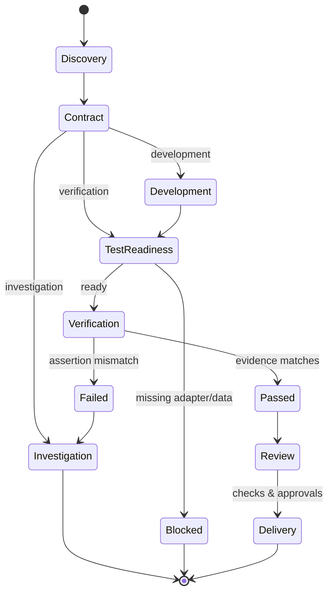

# Architecture and design decisions

## Bounded context

- **Copilot CLI** is the interactive AI agent runtime and human-facing router. Project agents and Skills are declarative instructions, not a self-executing AI workflow engine.
- **Python `sdlc/`** is an independent deterministic contract checker, task planner and demo verification runner. No LLM service, network or database connection.
- **Task Contract** declares intent, scope, risk, environment, acceptance criteria and a scenario path.
- **Scenario Catalog** holds ordered operations and test assertions; this is distinct from the Feature Map.
- **Feature Map** documents navigation, operation and gotchas from the user/verification perspective.
- **CI** runs deterministic checks; it does not grant an agent production authority.

## State machine

## Six quality gates

| Gate | Hard condition | Machine proof in v0.1 |
| --- | --- | --- |
| G1 Spec | task intent, acceptance criteria, scope, policy | `validate_task` |
| G2 Verifiability | scenario and assertions defined | `validate_scenario` |
| G3 Readiness | dependency order and approved adapter | `order_steps`; demo-only adapter check |
| G4 Execution | steps and checks recorded | `verify` evidence JSON |
| G5 Review/CI | unit tests, independent review | CI + reviewer guidance |
| G6 Release | human authorization / rulesets | **not automated** |

Do not assume G5 human review or G6 approval merely because a unit test passed.

## Evidence contract (v0.1)

`task_id`, `scenario_id`, `environment`, timestamp, `status`, `classification`, step-level evidence, expected-vs-actual checks, `limitations`, reason.

## Boundaries

Only `demo` environment uses the in-memory adapter. All other environments return BLOCKED without side effects. The Python runtime does not silently infer a test defect is a product defect.
